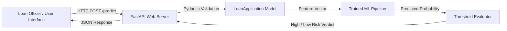

# Credit Risk Assessment & Loan Default Prediction Engine

[](https://github.com/sohammridha3-collab/project6)
[](https://www.python.org/)
[](https://fastapi.tiangolo.com/)
[](LICENSE)

An intelligent Credit Risk Assessment and Underwriting Engine designed for automated loan default risk prediction. This project pairs a machine learning risk model with a **FastAPI** backend and an **interactive underwriting web interface**.

---

## Key Highlights

- **Predictive ML Model**: Analyzes applicant credit history, financial profiles, and loan parameters to assess default probability.
- **Calibrated Decision Thresholding**: Employs an optimized decision threshold (`best_threshold.pkl`) to balance precision and recall for institutional risk management.
- **FastAPI Asynchronous Microservice**: Lightweight, high-throughput RESTful API with automated request validation via Pydantic.
- **Interactive Underwriting Desk UI**: Clean web dashboard featuring radial probability gauges, live loan-to-income recalculation, and instant decision badges.
- **Exploratory Data Analysis**: End-to-end training and evaluation pipeline documented in [`Credit_Risk.ipynb`](Credit_Risk.ipynb).
- **Cloud-Ready**: Includes configuration (`render.yaml`, `runtime.txt`) for one-click deployment to cloud platforms like Render.

---

## System Architecture



---

## Directory Structure

```
project6/
├── credit_risk_dataset.csv   # Historical credit & loan dataset
├── credit_risk_model.pkl     # Serialized trained ML pipeline
├── best_threshold.pkl        # Precomputed optimal decision threshold
├── Credit_Risk.ipynb         # Model development, EDA & SHAP analysis
├── main.py                   # FastAPI service & static file server
├── requirements.txt          # Python dependencies
├── render.yaml               # Cloud deployment descriptor
├── runtime.txt               # Python runtime specification
├── static/                   # Frontend assets
│   ├── index.html            # Underwriting desk interface
│   ├── style.css             # Interface styling & gauge design
│   └── script.js             # Client-side calculations & API integration
├── .gitignore                # Git ignore patterns
└── README.md                 # Project documentation
```

---

## Getting Started

### 1. Prerequisites
- Python 3.10 or 3.11 installed on your system.
- Git.

### 2. Clone the Repository
```bash
git clone https://github.com/sohammridha3-collab/project6.git
cd project6
```

### 3. Create and Activate a Virtual Environment
```bash
# Windows
python -m venv .venv
.venv\Scripts\activate

# macOS / Linux
python3 -m venv .venv
source .venv/bin/activate
```

### 4. Install Dependencies
```bash
pip install -r requirements.txt
```

### 5. Run the Application
Launch the FastAPI development server:
```bash
uvicorn main:app --reload --host 127.0.0.1 --port 8000
```

Open your browser and navigate to:
- **Interactive UI**: [http://127.0.0.1:8000](http://127.0.0.1:8000)
- **Interactive API Docs (Swagger UI)**: [http://127.0.0.1:8000/docs](http://127.0.0.1:8000/docs)
- **Alternative Docs (ReDoc)**: [http://127.0.0.1:8000/redoc](http://127.0.0.1:8000/redoc)

---

## API Reference

### `POST /predict`
Evaluates an applicant's loan request and calculates default probability.

#### Request Body
```json
{
  "person_age": 30,
  "person_income": 600000.0,
  "person_home_ownership": "RENT",
  "person_emp_length": 5.0,
  "loan_intent": "PERSONAL",
  "loan_grade": "B",
  "loan_amnt": 150000.0,
  "loan_int_rate": 11.5,
  "loan_percent_income": 0.25,
  "cb_person_default_on_file": "N",
  "cb_person_cred_hist_length": 4
}
```

#### Response Example
```json
{
  "default_probability": 0.1428,
  "default_prediction": 0,
  "threshold": 0.35,
  "Result": "Low Risk"
}
```

---

## Deployment

This repository includes a [`render.yaml`](render.yaml) configuration file for automated deployment on **Render**:
1. Connect your GitHub repository to [Render](https://render.com).
2. Choose **Blueprint** deployment.
3. Render will automatically detect `render.yaml`, install `requirements.txt`, and start `uvicorn main:app --host 0.0.0.0 --port $PORT`.

---

## Author & License

Maintained by [sohammridha3-collab](https://github.com/sohammridha3-collab).

Released under the [MIT License](LICENSE).
